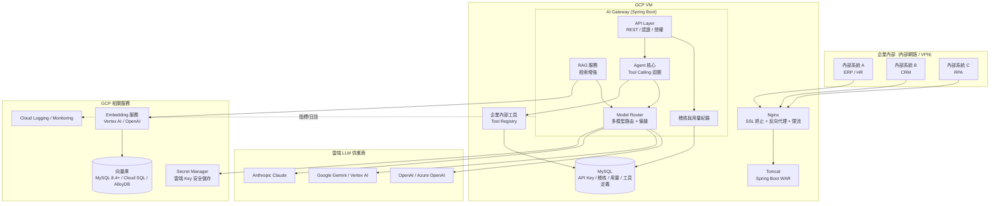
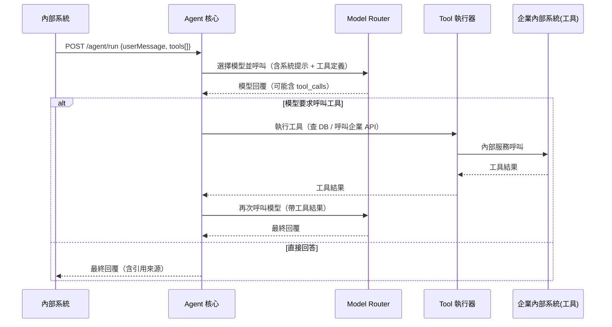

# 企業 AI Gateway 架構設計文件

> 版本：v0.2（已收斂決策）
> 目標：在 GCP 上建立企業落地 AI 閘道，統一接收內部系統 request，經由 AI Agent 層呼叫雲端多供應商 LLM，並集中控管（權限、稽核、成本、安全）。

## 0. 已確認決策

| # | 決策 |
|---|------|
| 1 | 支援串流輸出，設計為 `sse-enabled` / `sse-disabled` 選項（呼叫方可自行選擇） |
| 2 | 企業內部工具目前無 REST API → 進入開發前先「工具盤點 + 討論 API 規格」，列為 Phase 0 |
| 3 | RAG 知識來源：PDF、Word、TXT、網站、既有 DB |
| 4 | 管理後台（Web UI）最後階段再做，前期用設定檔 + SQL 管理 |
| 5 | 目前無雲端帳號，尚在評估付費 → 見「12. 供應商採購建議」 |
| 6 | 多語系支援採「應用層」方案，不安裝 OS 語言套件 → 見「7.x 多語系策略」 |

---

## 1. 目標與需求

| 需求 | 說明 |
|------|------|
| 統一 API 出口 | 內部系統只需呼叫本公司 API，不需直接接觸雲端 LLM，雲端 API Key 不外洩 |
| AI Agent 層 | 支援 **Tool calling**、**RAG 檢索增強**、**多模型路由與備援** |
| 多供應商支援 | OpenAI / Azure OpenAI / Google Gemini / Anthropic Claude 皆可接，可抽換 |
| 集中控管 | 認證授權、稽核日誌、用量成本統計、限流配額、敏感資料遮罩 |
| 部署環境 | GCP VM：OS + Nginx (SSL) + Tomcat + MySQL，技術棧使用 Java (Spring Boot) |

---

## 2. 整體架構圖



---

## 3. 部署拓撲（依現有 GCP 基礎設施）

```
                        (HTTPS :443)
內部系統 ───────────▶ Nginx
                      │  SSL 終止、HTTP/2、反向代理
                      │  server { proxy_pass http://ai-gateway:8080; }  # Nginx 已 Docker 化，走容器名
                      ▼
                     Tomcat (:8080)
                      │  部署 Spring Boot WAR
                      ▼
                   AI Gateway
                      │  存取
                      ▼
                    MySQL (:3306)
```

要點：
- **Nginx 負責**：SSL 憑證管理、TLS 終止、`proxy_pass` 轉送、基礎限流（`limit_req_zone`）、IP 白名單。
- **Tomcat 負責**：跑 Spring Boot 應用（WAR 部署），所有業務邏輯在應用層。
- **MySQL 負責**：持久化設定、稽核、用量、工具定義、對話紀錄。
- 應用內**不存雲端 API Key**，改從 GCP Secret Manager 讀取（Runtime 注入）。

---

## 4. Spring Boot 模組規劃

建議套件結構（Maven / Gradle 多 module 或單一 module 分層皆可）：

```
com.company.aigateway
├── api/            REST Controller、DTO、例外處理
├── security/       API Key 驗證、IP 白名單、JWT（如需）
├── audit/          稽核日誌、用量統計、批次寫入 MySQL
├── agent/          Agent 核心（tool calling 迴圈、對話狀態）
├── tools/          Tool 註冊表、工具呼叫執行器
├── router/         模型供應商抽象、路由策略、容錯備援
├── provider/       OpenAI / Azure / Gemini / Claude 各實作
├── rag/            檢索、Embedding client、向量查詢
├── config/         設定管理（DB / YAML / Secret Manager）
└── persistence/    MyBatis / JPA 存取 MySQL
```

技術建議：
- Spring Boot 3.x + Java 17+
- WebFlux（reactive）或 Web MVC + Spring `RestClient`（呼叫 LLM 用 SSE / streaming）
- LLM 串流建議用 WebFlux 或 `WebClient` 搭配 `text/event-stream`

---

## 5. AI Agent 層設計

### 5.1 核心流程（Tool Calling 迴圈）



要點：
- Agent 採「迴圈執行」：模型決定 → 執行工具 → 結果回饋 → 再次詢問，直到模型給出最終答案。
- 設定 **最大迭代次數**（如 10 次）防止無限迴圈。
- 每個工具呼叫都記錄進稽核日誌（誰、何時、哪個工具、參數、結果摘要）。

### 5.2 Tool Registry（工具註冊表）

- 工具定義存於 MySQL 或程式碼註冊，統一格式（OpenAI function schema 相容）：

```json
{
  "type": "function",
  "function": {
    "name": "query_employee",
    "description": "查詢員工基本資料",
    "parameters": {
      "type": "object",
      "properties": {
        "emp_no": { "type": "string" }
      },
      "required": ["emp_no"]
    }
  }
}
```

- 工具分為「**內部工具**」（企業系統 API、資料庫查詢）與「**外部工具**」（如 web search，需特別控管）。
- 工具層需做：參數驗證、結果大小上限、敏感欄位遮罩、呼叫逾時。

### 5.3 對話狀態與記憶

- 支援多輪對話：`session_id` 管理，context 存於 MySQL（或 Redis，如需要）。
- 每 session 限制 context 大小（token 估算），超過即做摘要壓縮（summarization）。

---

## 6. 多模型路由與備援（Model Router）

### 6.1 供應商抽象層

```java
public interface LlmProvider {
    ProviderInfo getInfo();
    ChatResponse chat(ChatRequest request);          // 非串流
    Stream<ChatChunk> stream(ChatRequest request);   // 串流
}
```

實作：
- `OpenAiProvider`（OpenAI API / 相容）
- `AzureOpenAiProvider`（Azure OpenAI，需 resource + deployment name）
- `GeminiProvider`（Google Gemini / Vertex AI）
- `ClaudeProvider`（Anthropic）

雲端 Key 全部放 GCP Secret Manager，Runtime 注入，不走設定檔/環境變數常駐。

### 6.2 路由策略

| 策略 | 用途 |
|------|------|
| Cost-first | 簡單任務走便宜模型（如 Gemini Flash），複雜任務走強模型 |
| Capability-based | 依需求選擇（如需長 context、需工具、需圖像） |
| 優先序列表 | 每種任務類型設定供應商優先序（`fallback_chain`） |
| Latency-based | 用量低延遲目標時，選擇實測較快的供應商 |

### 6.3 備援 / Failover

```
嘗試 Provider A（如 OpenAI）
   ├─ 成功 → 回傳
   ├─ 逾時 → 嘗試 Provider B（Gemini）
   ├─ 5xx / 429（配額）→ 嘗試 Provider C（Claude）
   └─ 全部失敗 → 回傳錯誤 + 完整錯誤碼
```

- 每次嘗試紀錄在用量表中（供應商、延遲、成功/失敗、成本）。
- 可用 **Circuit Breaker**（Resilience4j）防止對故障供應商連續呼叫。
- 429 配額錯誤自動等待後重試（指數退避）。

---

## 7. RAG 檢索增強

```
問題 → Embedding 模型（Vertex AI text-embedding / OpenAI embedding）
     → 向量查詢（MySQL 8.4+ VECTOR / Cloud SQL / AlloyDB）
     → Top-K 檢索片段
     → 組裝成 context（附來源）注入 prompt
     → 呼叫 LLM 產生回覆
```

建議：
- 先從 **MySQL 8.4+ 的 `VECTOR` 型別 + `DISTANCE()` 函式** 起步（免新增維運節點）。
- 規模變大再搬遷到 **AlloyDB / Vertex AI Vector Search**。
- 檢索結果必須附**來源引用**，回覆時可揭露來源增加可信度。
- 嵌入（embedding）也要走控管出口，計入用量。

### 7.1 知識來源與擷取（Ingestion）

| 來源 | 擷取方式 | 中文支援注意 |
|------|----------|--------------|
| PDF | Apache PDFBox / pdfplumber 擷取文字 | PDF 內嵌字型需正確對應，純擷取不需作業系統字型 |
| Word (.docx) | Apache POI 讀取段落與表格 | 不需 OS 字型，POI 直接讀 XML |
| TXT / Markdown | 直接讀取，依段落切分 | 需確認檔案編碼 UTF-8 |
| 網站 | 定期爬蟲（尊重 robots.txt）+ HTML→文字清洗 | 注意回應編碼宣告 |
| DB | 直接 SQL 讀取既有資料表 | 需 DB 連線帳號權限控管 |

共通流程：**讀取 → 清洗 → 依 token/字數切塊（chunk）→ Embedding → 寫入向量表**，並記錄 `source`、`doc_id`、`version` 以便更新/失效。

**重要：所有擷取與文字處理都在 Java 應用層完成（Apache POI / PDFBox），不依賴 OS 語言套件，中文編碼統一由「應用層強制 UTF-8」處理。**

### 7.2 多語系策略（應用層方案，不安裝 OS 語言套件）

多語系完全不需在 OS 裝任何東西，全部在 Java 應用層處理：

| 層級 | 做法 |
|------|------|
| 編碼規範 | 全系統強制 **UTF-8**：MySQL `utf8mb4`、JDBC `characterEncoding=UTF-8`、HTTP `Content-Type: application/json; charset=UTF-8`、Tomcat URIEncoding 一致。這是多語系的根基 |
| 輸入/輸出理解 | LLM 本身內建多語系能力，直接以使用者語言回答，**不用翻譯層** |
| 檢索 | 使用多語 embedding 模型（如 Vertex AI text-embedding / multilingual 版本），跨語言檢索一致 |
| 後台/系統訊息（開發後期） | Spring Boot 國際化：`messages_zh_TW.properties` / `messages_en.properties` + `LocaleResolver` |
| 產出文件（PDF/Word 輸出，若需） | 若應用要「產生」PDF/Word，把 CJK 字型檔案**打包進應用**（如 NotoSansCJK），由 iText/OpenPDF 載入；不讀 OS 字型 |
| 字型 | 若只是「擷取」PDF/Word 文字內容，完全不需字型；需要字型只發生在「渲染/產生」文件或圖片時 |

> 唯一「看似需要 OS 語言包」的情境是：要把中文渲染成 PDF/圖片。解法是把字型檔放在應用專案內，與 OS 無關。
> 資料庫欄位建議一律 `VARCHAR ... CHARACTER SET utf8mb4`，才能存中文、emoji、多語文字。

---

## 8. 資料庫設計（MySQL）

| Table | 用途 | 主要欄位 |
|-------|------|----------|
| `api_client` | 呼叫端（內部系統） | id, name, api_key_hash, ip_allowlist, quota, enabled |
| `model_route_config` | 任務型別 → 模型/供應商/備援鏈 | task_type, provider, model, fallback_chain, weight |
| `audit_log` | 稽核日誌 | id, client_id, request_id, endpoint, prompt_hash, response_hash, timestamp |
| `usage_log` | 用量/成本 | id, session_id, provider, model, prompt_tokens, completion_tokens, cost_usd, latency_ms, success |
| `conversation` | 多輪對話記憶 | session_id, client_id, messages, token_count, updated_at |
| `tool_registry` | 工具定義 | id, name, description, schema_json, endpoint, enabled |
| `rag_document` | ~~知識庫文件（已棄用）~~ 改為 **Embedded Solr rag core**（DenseVectorField 3072d） | |
| `api_client` API Key 僅存雜湊，永不存明文 | | |

---

## 9. API 設計草案（v1）

```
POST /api/v1/chat         一般問答（多輪，JSON 回覆）
POST /api/v1/chat/stream  串流問答（SSE，事件格式見 9.1）
POST /api/v1/agent/run    Agent 執行（可帶 tools[]）
POST /api/v1/rag/query    純檢索（不呼叫 LLM，撈原文片段）
POST /api/v1/rag/ask      RAG 問答（檢索 + LLM 依知識庫直接給答案，2026-08-29 新增）
GET  /api/v1/usage/me     查詢本系統用量與配額
GET  /api/v1/health       健康檢查
```

Request 範例（`/api/v1/agent/run`）：

```json
{
  "session_id": "sess_001",
  "user_message": "幫我查員工編號 1001 的部門",
  "tools": ["query_employee", "query_dept"],
  "options": {
    "task_type": "internal_query",
    "stream": true,
    "max_tool_rounds": 5
  }
}
```

Response（stream=false）：

```json
{
  "request_id": "req_abc",
  "session_id": "sess_001",
  "message": "員工 1001 屬於資訊部。",
  "tool_calls": [
    { "tool": "query_employee", "status": "ok" }
  ],
  "citations": [
    { "source": "hr_db.employee", "ref": "emp/1001" }
  ],
  "usage": {
    "provider": "openai",
    "model": "gpt-4o-mini",
    "prompt_tokens": 512,
    "completion_tokens": 40,
    "cost_usd": 0.0003
  }
}
```

### 9.1 串流輸出設計（SSE）

> 實作決議（2026-08-21）：串流改用**獨立端點** `POST /api/v1/chat/stream`（Spring MVC 的 SseEmitter 必須由 controller 直接回傳，無法與 JSON 共用同一端點的回傳型別）。事件格式如下，`stream` body 欄位保留但不再控制輸出模式。

- `Content-Type: text/event-stream`，事件格式：

```
event: message            # 文字增量
data: {"delta":"員工 1001 "}

event: message
data: {"delta":"屬於資訊部。"}

event: tool_call          # 工具呼叫進度（可選）
data: {"tool":"query_employee","status":"started"}

event: usage              # 結束，帶用量與引用
data: {"request_id":"req_abc","usage":{...},"citations":[...]}

event: done
data: {}
```

- 後端對雲端 LLM 的串流使用 WebClient 接 `text/event-stream` 增量轉送；Client 斷線（Connection: close）即取消上游呼叫並釋放資源。
- `stream: false` 時為一般 JSON 回覆（如前面範例）。
- 對下游暴露的統一協定，才不會讓每個呼叫端各自去相容各家串流格式。

---

## 10. 安全與控管（重點）

| 項目 | 做法 |
|------|------|
| 身分認證 | 每系統發一組 API Key（存 SHA-256 雜湊），可搭配 IP 白名單 |
| 傳輸安全 | Nginx TLS 1.2+，內部 HTTP 走本機回送 |
| 敏感資料 | prompt/回覆遮罩（身分證、電話、信用卡）於寫入稽核日誌前處理；PII 遮罩服務可接 GCP DLP |
| 權限 | 工具層級授權：不同 client 只能呼叫被授權的工具 |
| 限流配額 | Nginx 層限流 + 應用層每日/每小時配額，超過回 429 |
| 稽核 | 所有 request 全紀錄（除敏感欄位外），保留 N 天 |
| 雲端 Key | GCP Secret Manager，不進程式碼/設定檔 |
| Prompt 注入防護 | 系統提示固定、限制工具參數、對不可信輸入做分隔 |

---

## 11. 實作藍圖（建議分階段）

### Phase 0：工具盤點與規格討論（約 1 週）
- 與使用者盤點企業內部「想做哪些工具」（查員工、查庫存、查訂單…）
- 共同訂出每個工具的 REST API 規格（輸入/輸出/授權），因為目前企業內部工具無既有 REST API
- 產出工具清單文件，之後才進入開發

### Phase 1：閘道 MVP（約 1-2 週）
- Spring Boot 專案骨架 + Nginx / Tomcat / MySQL 連線
- `POST /api/v1/chat`（含 `stream` 選項）+ API Key 認證 + 稽核日誌落 DB
- 接一個供應商，串流（SSE）與非串流都支援

### Phase 2：多供應商 + 路由備援（約 1-2 週）
- Provider 抽象層完成，接齊 OpenAI / Azure / Gemini / Claude
- Model Router + failover + 用量成本統計

### Phase 3：Agent + Tool calling（約 2 週）
- 依 Phase 0 規格實作第一個真實內部工具 API（或先以 Mock 工具驗證）
- Tool Registry + 工具執行迴圈 + 稽核

### Phase 4：RAG（約 2-3 週）
- 多格式擷取管線（PDF / Word / TXT / 網站 / DB）+ Embedding + 向量庫 + 引用
- 匯入第一批企業知識文件

### Phase 5：強化控管與上線（約 1-2 週）
- 限流配額、敏感遮罩、GCP 監控告警、壓力測試、上線

### Phase 6：管理後台（最後階段）
- Web UI：管理 API Client、路由設定、用量報表、工具註冊、文件管理

---

## 12. 供應商採購建議

### 結論：第一個先買 **Google Gemini（走 Vertex AI）**，第二個再補 **OpenAI**。

| 考量 | Google Gemini（Vertex AI） | OpenAI |
|------|---------------------------|--------|
| 與現有 GCP 整合 | ✅ 同一朵雲：帳單合一、低延遲、資料落地（可選區域） | 需額外帳號、跨雲流量 |
| RAG 所需 Embedding | ✅ 內建 embedding 模型（text-embedding，多語） | ✅ 有，但需另計 |
| 中文/多語能力 | ✅ 中文表現佳 | ✅ 中文表現佳 |
| Tool calling 成熟度 | ✅ 佳（function calling） | ✅ 最成熟、文件最多 |
| 便宜驗證 | ✅ Gemini Flash 成本極低 | ✅ GPT-4o-mini 亦便宜 |
| 免費試用 | ✅ Google AI 免費額度 / Vertex 試用點數 | ✅ OpenAI 註冊送試用額度 |

理由：
1. 你的服務已在 GCP，Vertex AI 同雲整合最省事（帳單、IAM、網路、資料落地）。
2. Vertex AI 同時提供 **Chat 與 Embedding 模型**，Phase 1 與 Phase 4（RAG）可一處搞定。
3. Gemini Flash 價格低，適合先跑通流程、驗證中文品質與成本。

OpenAI 作為 **第二供應商** 補足：Tool calling 生態最成熟、作為 failover 備援、以及未來接 o 系列等更強模型。

> 建議「先不付錢驗證」：OpenAI 註冊有試用額度，Google 也有免費層（AI Studio / Vertex 試用點數）。先用免費額度同時測兩家，各跑一組**中文測試題 + 工具呼叫情境**，比對品質與成本後再決定正式付費，並把比較結果記錄下來。

### 付費後的務實路線
- Gemini：從 **Flash** 起（任務簡單、成本低），複雜任務升級 **Pro**。
- OpenAI：從 **GPT-4o-mini** 起，驗證後再評估 GPT-4o / o 系列。
- 兩家都買到後，靠 Model Router 的 cost-first / fallback 策略自動分流。

---

## 13. 剩餘開放問題

1. 內部工具的「情境」請開始盤點：哪些系統資料最想先讓 AI 查詢？（例如：員工資料、庫存、訂單、法規文件…）
2. 知識庫文件大致數量級？（先估：<1萬頁 / 1-10萬頁 / 以上）決定向量庫方案。
3. 串流是否也要讓呼叫端在 Agent 工具執行階段看到進度（tool_call 事件）？還是只要最終文字串流即可？
4. 是否需要「回覆前人工審核」的流程（某些回覆需人批）？

